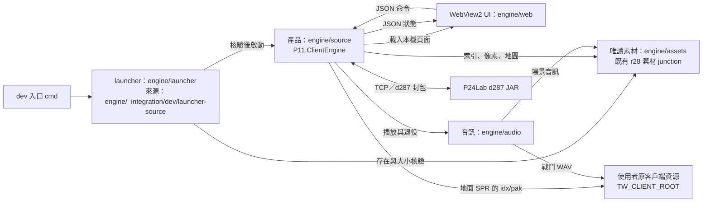

# tw-bin-engine：模組與資料流

這是以 C#／.NET 10、WinForms 與 WebView2 重寫的天堂客戶端，執行時不啟動原 `LiTo.bin`，目前對接 P24Lab **d287 JAR** 伺服器。
依據：[產品入口](../engine/source/ProductEntry.cs)、[主程式](../engine/source/Program.cs)、[協定 profile](../engine/source/LoginProtocol.cs)。

本文按 `origin/main` 的 `31931256008607d9df21558d2fa26ed7e3d32bf9` 靜態核對（2026-11-06）。
這是評分用的原始碼導覽；功能是否通過真機驗收，另看 [Demo 證據](demo/README.md) 與 [TASKS](../TASKS.md)。

## 元件與依賴方向

箭頭表示呼叫、載入或讀取；雙向箭頭表示命令與回應。伺服器是外部程序。

- `engine/launcher` 是 launcher 輸出位置；可審閱的來源在 [Program.cs](../engine/_integration/dev/launcher-source/Program.cs)。
- 主程式組件名稱、WinForms／WebView2 參考與音訊專案依賴見 [OfflineClient.csproj](../engine/source/OfflineClient.csproj)。
- `engine/assets` 與原客戶端目錄是**兩層資源**：既有 junction 指向 r28 衍生素材，並非直接指向原客戶端。
  資源約定見 [BUILD](BUILD.md)；圖中的素材目錄不在 Git 內，本頁不宣稱乾淨 clone 自帶素材。
- 正常 UI 包含 WinForms 登入與 HUD；WebView2 是可開關的面板，非全部遊戲畫面的繪圖器（[WebPanel.cs](../engine/source/WebPanel.cs)、[Program.cs](../engine/source/Program.cs)）。

## 模組表

下表檔名均相對 `engine/source`；這些功能多以 `ClientForm`、`LoginConnection`、`WorldSession` 的 partial class 分檔。
「有實作」不等於「已完成真機驗收」，尤其 NPC、跨圖與 6016 尚須對照 TASKS。

| 分組 | 代表檔案 | 一句職責 |
|---|---|---|
| 登入／網路與協定 | [LoginControl.cs](../engine/source/LoginControl.cs)、[LoginConnection.cs](../engine/source/LoginConnection.cs)、[LoginProtocol.cs](../engine/source/LoginProtocol.cs)、[ClientLogin.cs](../engine/source/ClientLogin.cs) | 檢查登入操作、維護 TCP 工作階段，完成分框、加解密、角色清單與畫面同步。 |
| 世界與移動 | [WorldSession.cs](../engine/source/WorldSession.cs)、[WorldEntry.cs](../engine/source/WorldEntry.cs)、[WorldObjects.cs](../engine/source/WorldObjects.cs)、[OnlineMovement.cs](../engine/source/OnlineMovement.cs) | 接收角色／地圖／可見物件狀態，管理進世界條件、移動請求與伺服器校正。 |
| 戰鬥與魔法 | [Combat.cs](../engine/source/Combat.cs)、[Magic.cs](../engine/source/Magic.cs)、[Ranged.cs](../engine/source/Ranged.cs) | 編碼攻擊／施法請求，套用戰鬥回報、動畫時序與弓箭距離規則。 |
| 道具／背包／地面物品 | [Inventory.cs](../engine/source/Inventory.cs)、[Ground.cs](../engine/source/Ground.cs)、[GroundCatalog.cs](../engine/source/GroundCatalog.cs)、[GroundUi.cs](../engine/source/GroundUi.cs) | 以權威回包維護數量與地面物件，檢查使用、丟棄及拾取的選取與數量。 |
| 裝備 | [Equipment.cs](../engine/source/Equipment.cs) | 解析裝備狀態與槽位，供穿脫及其他操作門檻使用。 |
| 地圖資源與快取 | [Assets.cs](../engine/source/Assets.cs)、[MapResources.cs](../engine/source/MapResources.cs)、[OriginalMapCache.cs](../engine/source/OriginalMapCache.cs) | 核對素材、讀取已封裝地圖與 TIL，維持移動式 2×2 區塊快取。 |
| 特效與 6016 | [MapEffects.cs](../engine/source/MapEffects.cs)、[WorldEffect6016.cs](../engine/source/WorldEffect6016.cs)、[ClientEffect6016.cs](../engine/source/ClientEffect6016.cs) | 載入特效幀，按地圖區塊同步 6016 生命週期並在退役時清除。 |
| 音效 | [ClientCombatSfx.cs](../engine/source/ClientCombatSfx.cs)、[AudioApiTransport.cs](../engine/source/AudioApiTransport.cs) | 將戰鬥事件與 6016 主控轉交音訊組件，套用音量、靜音與關閉政策。 |
| UI 與輸入 | [Program.cs](../engine/source/Program.cs)、[OnlineInput.cs](../engine/source/OnlineInput.cs)、[PlayerPointer.cs](../engine/source/PlayerPointer.cs)、[PlayerHudView.cs](../engine/source/PlayerHudView.cs)、[WebPanel.cs](../engine/source/WebPanel.cs) | 組成原生視窗、鍵盤／點地操作、HUD 及 WebView2 JSON 橋接。 |
| 畫面合成 | [Renderer.cs](../engine/source/Renderer.cs)、[ObjectRendering.cs](../engine/source/ObjectRendering.cs)、[GroundRendering.cs](../engine/source/GroundRendering.cs) | 將地圖、角色、地面物品與特效合成像素，再交給 WinForms 繪製。 |
| 診斷與封包追蹤 | [PacketTrace.cs](../engine/source/PacketTrace.cs)、[EventJournal.cs](../engine/source/EventJournal.cs) | 選用封包追蹤只記方向、opcode、長度、時間及接收序號；事件日誌另記 UI 診斷。 |
| 離線測試／回歸（非產品功能） | [LoginTests.cs](../engine/source/LoginTests.cs) 的 `Vectors`、[MovementRegression.cs](../engine/source/MovementRegression.cs) | 前者核對加解密與分框向量，後者以捕獲資料及替代傳送門檻檢查移動回歸。 |

`*Tests.cs`／`*Regression.cs` 是測試入口，不列作產品功能；上表離線分類限定所列函式。
例如 `LoginTests.Probe` 會連測試端點，不能因檔名就當成離線測試，也不能把測試通過當成實機通過。

## 五條資料流

### 1. 啟動：入口 → 核驗 → 產品

1. [啟動引擎.cmd](../啟動引擎.cmd) 是歷史正式入口，仍轉往 r33；目前開發產品使用
   [engine/啟動新版客戶端.cmd](../engine/啟動新版客戶端.cmd)，將參數傳給 `engine/launcher` 的執行檔。

2. [launcher-source/Program.cs](../engine/_integration/dev/launcher-source/Program.cs) 的 `Main` 解析 `--check-only`，
   由 launcher 所在位置決定產品根目錄，再呼叫 `Verify`。

3. 同一 [Program.cs](../engine/_integration/dev/launcher-source/Program.cs) 核對產生的 dev manifest、profile、入口參數，
   逐檔核對產品 size／SHA-256；素材索引另逐檔核對存在及大小，並檢查 Desktop Runtime、WebView2 Runtime。

4. 同一 [Program.cs](../engine/_integration/dev/launcher-source/Program.cs) 在 check-only 分支輸出 JSON 後直接返回；
   正常分支才 `Process.Start`，傳入唯一參數 `--normal-product`，不自動登入。

5. [source/Program.cs](../engine/source/Program.cs) 的 `Main` 透過 [ProductEntry.cs](../engine/source/ProductEntry.cs) 判定正常模式，
   建立 `Assets`、`ClientForm`，再進入 `Application.Run` 的 WinForms 訊息迴圈。

6. [ClientLogin.cs](../engine/source/ClientLogin.cs) 建立登入操作；[WebPanel.cs](../engine/source/WebPanel.cs) 按需初始化 WebView2，
   將本機 `engine/web` 映射為虛擬站台並註冊訊息橋接。

### 2. 登入與選角 → 進世界

1. [ClientLogin.cs](../engine/source/ClientLogin.cs) 的 `StartLogin`／`BeginLogin` 將手動輸入交給
   [LoginControl.cs](../engine/source/LoginControl.cs) 的 `Start`，檢查狀態、generation、revision 與端點設定。

2. [LoginConnection.cs](../engine/source/LoginConnection.cs) 的 `Run` 連線至允許的本機埠；正常 profile 固定使用 P24Lab 42061，
   TCP 位元組交給 [LoginProtocol.cs](../engine/source/LoginProtocol.cs) 的 `LoginFrames.Feed` 組成完整封包。

3. [LoginProtocol.cs](../engine/source/LoginProtocol.cs) 的 `LoginPackets.Seed` 辨認交握，`LoginCipher` 建立收送狀態；
   [LoginConnection.cs](../engine/source/LoginConnection.cs) 送出登入資料，解析登入結果、公告與角色清單。

4. [LoginControl.cs](../engine/source/LoginControl.cs) 的 `Enter` 限定選擇本次清單中的角色；
   [WorldSession.cs](../engine/source/WorldSession.cs) 的 `SelectCharacter` 送出選角 C137，轉為 `EnteringWorld`。

5. [WorldSession.cs](../engine/source/WorldSession.cs) 接收 EnterGame、角色狀態、地圖與自身 S87，形成 `CoreComplete`；
   [WorldEntry.cs](../engine/source/WorldEntry.cs) 的 `PumpWorldAsync` 送時間探測，等待回應並啟動非同步地圖載入。

6. [WorldEntry.cs](../engine/source/WorldEntry.cs) 的 `CompleteMapLoad`／`PublishWorldProgress` 更新地圖與登入階段；
   [WorldSession.cs](../engine/source/WorldSession.cs) 的 `Renderable` 還要求支援的地圖、外觀與無換圖等待。

7. [ClientLogin.cs](../engine/source/ClientLogin.cs) 的 `SyncWorld` 同步角色位置、背包與面板；
   [Program.cs](../engine/source/Program.cs) 的計時器重繪世界，未滿足條件時顯示等待／不可用資訊。

### 3. 收到一個 S87 物件封包 → 畫面

以下以已在世界內的非自身物件為例；不是每個 opcode 都產生同一種物件。

1. [LoginConnection.cs](../engine/source/LoginConnection.cs) 的 `Run` 從 socket 讀取資料；
   [LoginProtocol.cs](../engine/source/LoginProtocol.cs) 完成分框與解密，取得明文 opcode 87。

2. [LoginConnection.cs](../engine/source/LoginConnection.cs) 呼叫 [WorldEntry.cs](../engine/source/WorldEntry.cs) 的 `ApplyWorldPacket`，
   再經 [PickupPresentation.cs](../engine/source/PickupPresentation.cs) 的 `ReceiveOwned` 交給 `Receive`，維持工作階段邊界。

3. [WorldSession.cs](../engine/source/WorldSession.cs) 的 `ReceiveCore` 讀出位置與 object ID，
   非自身 S87 交給 [WorldObjects.cs](../engine/source/WorldObjects.cs) 的 `ReceiveObject` 解碼外觀等欄位。

4. [WorldObjects.cs](../engine/source/WorldObjects.cs) 更新物件集合；符合地面 catalog envelope 的資料則交給
   [Ground.cs](../engine/source/Ground.cs) 的 `ReceiveGround`，更新地面物品與 revision。

5. [WorldEntry.cs](../engine/source/WorldEntry.cs) 的 `PublishWorldProgress` 發布狀態；
   [ClientLogin.cs](../engine/source/ClientLogin.cs) 訂閱 `login.Changed`，執行 `SyncWorld` 並更新 Web 狀態。

6. [Program.cs](../engine/source/Program.cs) 的 `RefreshSceneImage` 在可繪製時呼叫
   [ObjectRendering.cs](../engine/source/ObjectRendering.cs) 的 `RefreshObjects`／`ComposeObjects`，取得外觀並合成像素。

7. [Renderer.cs](../engine/source/Renderer.cs) 將合成結果轉成 bitmap；
   [Program.cs](../engine/source/Program.cs) 的 `OnPaint` 依相機位置繪出背景、物件區塊及選取提示。

### 4. 使用者丟棄物品 → 請求 → 權威回應

以伺服器允許丟棄、catalog 已啟用的物品為例；金幣的限制見 B14。

1. [engine/web/panel.js](../engine/web/panel.js) 的丟棄按鈕呼叫 `countCommand`，
   以 `chrome.webview.postMessage` 傳送 `drop`、數量與當時選取快照。

2. [WebPanel.cs](../engine/source/WebPanel.cs) 的 `DispatchWeb` 檢查來源、欄位、世界 epoch 與 item ID，
   然後交給 [GroundUi.cs](../engine/source/GroundUi.cs) 的 `WebGround`；原生按鈕經 `NativeGroundQuantity` 匯入相同核心。

3. [GroundCatalog.cs](../engine/source/GroundCatalog.cs) 的 `SendGroundQuantity` 驗證整數數量、持有量及快照版本，
   拒絕過期選取後才呼叫 [Ground.cs](../engine/source/Ground.cs) 的 `SendGround`。

4. [Ground.cs](../engine/source/Ground.cs) 檢查動作、裝備及忙碌狀態，建立 C25 請求；
   取得傳送鎖後再次檢查有效性，避免排隊期間的世界或選取變動造成錯送。

5. [LoginConnection.cs](../engine/source/LoginConnection.cs) 的 `sendMovementGate` 經 `LoginCipher` 與 `LoginFrames.Wrap`
   寫入 socket；[Ground.cs](../engine/source/Ground.cs) 只公告已送出，不在此扣背包數量。

6. 回包沿上一節接收路徑進入 [Inventory.cs](../engine/source/Inventory.cs) 的 `ReceiveInventory`：
   S24／S242 更新數量，S57 移除物品；S87 另由 [Ground.cs](../engine/source/Ground.cs) 建立或更新地面物件。

7. [ClientLogin.cs](../engine/source/ClientLogin.cs) 同步背包／地面面板，[WebPanel.cs](../engine/source/WebPanel.cs) 發布新狀態，
   [GroundRendering.cs](../engine/source/GroundRendering.cs) 合成地面圖；實際成功與否以權威回包為準。

### 5. 素材：原客戶端 → 唯讀載入 → 像素／聲音

以下素材檔名是**執行期路徑契約**，不是 Git 追蹤檔；每步連結的是可核查的讀取程式。

1. 依 [BUILD](BUILD.md) 準備既有 `engine/assets` junction，保留使用者原客戶端目錄；
   [Program.cs](../engine/source/Program.cs) 從產品位置推導 `../../assets`，正常入口不接受額外診斷參數。

2. [Assets.cs](../engine/source/Assets.cs) 讀取 `integrity.json`，核對非串流地圖素材的 SHA-256；
   再讀 `scene/manifest.json`、`scene/tile-pixels.json`、`scene/draw-commands.json`、`character/blocks.json` 與 `character/animation.json`。

3. [ObjectAssets.cs](../engine/source/ObjectAssets.cs) 依素材內 `objects/manifest.json` 與外觀 catalog 載入角色／物件幀；
   一般角色使用已整理的像素與動畫資料，不是每幀重新解開整個 pak。

4. [WorldEntry.cs](../engine/source/WorldEntry.cs) 建立 `OriginalMapCache`；[OriginalMapCache.cs](../engine/source/OriginalMapCache.cs) 從
   `assets/maps/manifest.json` 指定的地圖、terrain 與 `tiles/*.til` 讀取並核 SHA，解碼已支援的 S32／限定 SEG。

5. 同一 [OriginalMapCache.cs](../engine/source/OriginalMapCache.cs) 維護四個區塊槽位，移動時載入／退役並發布場景；
   [Renderer.cs](../engine/source/Renderer.cs)／[ObjectRendering.cs](../engine/source/ObjectRendering.cs) 使用快取與外觀合成畫面。

6. 地面 SPR 是直接讀原客戶端的支線：[GroundSpriteReader.cs](../engine/source/GroundSpriteReader.cs) 由 `TW_CLIENT_ROOT`
   讀 `Sprite.idx`／`Sprite.pak` 的核定片段，驗證索引與 payload SHA 後解碼；不經 `engine/assets`，也不解包複製素材。

7. 場景音訊由 [AudioApiTransport.cs](../engine/source/AudioApiTransport.cs) 傳入素材根；[audio/AudioAssets.cs](../engine/audio/AudioAssets.cs)
   依 `audio-manifest.json` 載入 `sound`。戰鬥音訊則由 [ClientCombatSfx.cs](../engine/source/ClientCombatSfx.cs) 傳入原客戶端根，讀核定的 `Sound/*.wav`。

8. [audio/AudioPlayer.cs](../engine/audio/AudioPlayer.cs) 管理播放佇列與生命週期，經 [DirectShowDriver.cs](../engine/audio/DirectShowDriver.cs) 播放；
   [WorldEffect6016.cs](../engine/source/WorldEffect6016.cs) 將區塊退役傳給 6016 host，避免舊場景事件留存。

## 建置與可重現

- 操作入口與資源前置見 [BUILD](BUILD.md)；dev 來源 size／SHA-256 清單見 [rebuild-lock.json](../engine/_integration/dev/rebuild-lock.json)，
  核驗／建置入口見 [rebuild.py](../engine/_integration/dev/rebuild.py)。來源 lock、產物 manifest 與執行期狀態各負不同責任。
- T006／#91 的雙目錄逐位元比較、證據與限制見 [issue-91.md](reports/issue-91.md)。
  [主程式](../engine/source/OfflineClient.csproj)、[音訊](../engine/audio/P24.Audio.csproj)、[launcher](../engine/_integration/dev/launcher-source/Launcher.csproj) 保留 `Deterministic`／`PathMap`，停用 Source Link 與版本字串的 Git revision 注入。
- 現行 [CI](../.github/workflows/build.yml) 在 `ubuntu-latest` 交叉建置 Windows 目標、核 dev lock 並跑獨立封包追蹤測試；
  BUILD 的 CI 舊段落仍寫 Windows，平台以 YAML 為準。CI 成功不代表 Windows UI、登入與音效實機通過。

## 已知限制

以下編號與範圍均取自 [TASKS 的 Backlog](../TASKS.md)。

- **B01**：技能擴充到各職業基本技能仍在 Backlog。
- **B03／B04**：map-local group fade 與 6016 以外的動畫事件尚有來源／語義缺口。
- **B06**：部分道具缺地面 sprite pin，對應地面圖目前停用。
- **B07**：Themida 執行期初始化阻礙原生分類全鏈與音效選擇語義；產品採主控政策。
- **B13**：協定只對齊目前 P24Lab d287 JAR，不宣稱相容其他伺服器或完整原 BIN 協定。
- **B14**：本伺服器規則不允許丟金幣，Demo 使用替代物品驗證丟撿。
