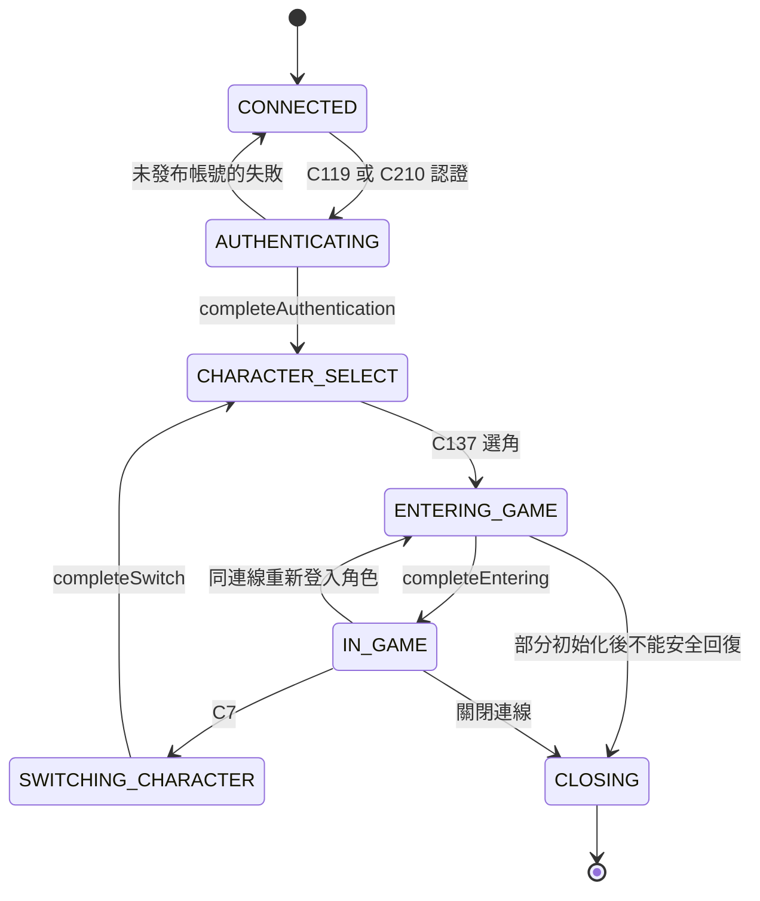
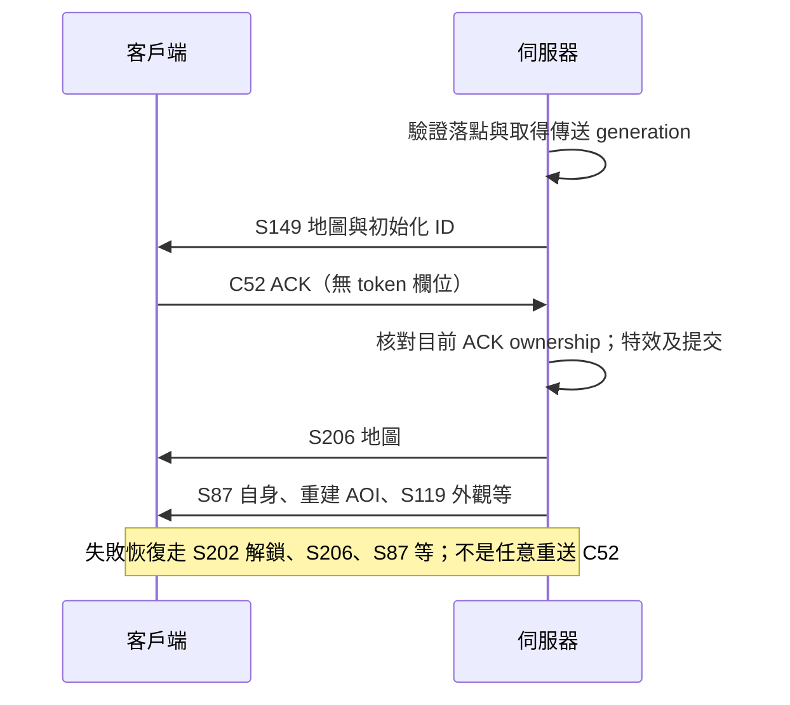

# 主伺服器規則與狀態機

Issue #132，2026-11-06 唯讀來源查核。封包數值、欄位與 overload 見 [server-protocol.md](server-protocol.md)；引擎對照與優先序見 [issue-132.md](../reports/issue-132.md)。

本文件的「已驗證」指已核對目前 `1-伺服器/src` 原始碼，並非執行遊戲、查詢 DB 或核對部署 JAR。來源以文末完整相對路徑與 SHA-256 識別；每條規則列出類別與方法。設定開關、角色數值、掉落率、物品模板及技能資料的實際內容未讀取，不把條件分支寫成正式服現況。原始碼是伺服器規則的依據；sprite 幀、地圖音效與圖像資產仍須查對應客戶端資源。

## 登入、選角與連線世代

圖為正常路徑與主要失敗路徑摘要；完整回復規則以 R02 為準。

| ID | 已驗證規則與客戶端含義 | 來源類別與方法 |
|---|---|---|
| R01 | 入站先檢查連線 phase／帳號／目前角色，再做結構 preflight，最後呼叫 handler。TRANSPORT（14、99、122）可在未關閉階段進入；AUTH 只在 CONNECTED；SELECTION 只在 CHARACTER_SELECT；ENTER_WORLD 在選角或 IN_GAME；GAME 只在 IN_GAME。未知 opcode 預設拒絕。C210/type11 僅放行到結構檢查及忽略出口，不做認證。 | `PacketHandler.handlePacket`；`SessionPacketPolicy.family/allows/isIgnoredControl`；`SessionPhaseGate.allowNow/capture` |
| R02 | 非同步工作帶 phase 世代及 ActiveCharacterBinding；切角、重連後舊請求不能作用到新角色。認證失敗且帳號尚未發布可回 CONNECTED；進入／切角中若無 activeChar 可回選角，舊 binding 仍有效時可回 IN_GAME，其他部分初始化失敗關閉。 | `SessionPhaseGate.Lease.completeAuthentication/completeEntering/completeSwitch/abort`、`Permit`；`ClientExecutor.captureActiveCharacterBinding` |
| R03 | C119 讀 account/password，帳號轉小寫，長度至多 12／13；帳號只接受英數，密碼接受英數及 `!_=+-?.#`（字元檢查轉小寫，實際密碼比較仍是原字串）。空值由 checkLogin 拒絕。成功先綁定帳號、完成 phase，再送 S233；若啟用公告送 S48，否則直接送角色清單。不要把連線成功視為認證成功。 | `C_AuthLogin.start/checkLogin`；`C_AutoLogin.start` |
| R04 | C16 觸發選角清單刷新：S178 角色數／槽位，之後逐角色 S93。公告不啟用時，成功認證直接走同一 refresh 方法；不能硬性等待公告。新建／刪除角色也是選角階段請求，不能拿世界物件 ID 代替角色名稱。 | `C_CommonClick.start/refreshAndSendCharacterList`；`C_CreateChar.start`；`C_DeleteChar.start`；`S_CharAmount`、`S_CharPacks` |
| R05 | C137 先驗證帳號對 charName 的所有權與持久化身分，再建立 activeChar 及初始化世界；包含 S223、S8、S206、S87 等及大量設定／物品／技能封包。初始化成功才 completeEntering。這是多封包流程，不能假設四個核心包是完整清單或唯一固定相鄰順序。 | `C_LoginToServer.start/isCurrentLoginRequest/loadAuthorizedCharacter`；`SessionPhaseGate.Lease.completeEntering` |
| R06 | C26 的 type/button 是顯示世界頻道、密語及交易聊天設定，並不是角色登入成功訊號。C95 是 keepalive／S123 時間更新；客戶端拿它當本地 ready 探測是引擎政策，不是伺服器狀態機完成條件。C7 切角與 C122 離線分別交由切角／離線處理。 | `C_LoginToServerOK.start`；`C_KeepALIVE.start`；`C_NewCharSelect.start`；`C_Disconnect.start` |

## 移動、權威座標與可見物件

| ID | 已驗證規則與客戶端含義 | 來源類別與方法 |
|---|---|---|
| R07 | C29 的 x/y 是來源格。八方向 `(dx,dy)` 依序為 `(0,-1),(1,-1),(1,0),(1,1),(0,1),(-1,1),(-1,0),(-1,-1)`。目的格一律從伺服器當前座標加方向；本快照只要 client base 與 server base 不同即拒絕並安排校正。 | `C_MoveChar.start/clientDriftChebyshev/softBlockMove` |
| R08 | 移動在 PlayerActionLock 下再驗角色狀態、動作間隔、地圖界限／通行、位置同步及地監入口。死亡、傳送、THUNDER_GRAB、私商、麻痺、MOVE_STOP 等會阻擋；不能只憑本地地圖認定可移。只有步進或入口提交後才清冥想／呼叫盟友目的地並提交 pacing；接受移動會取消緩衝中的物理攻擊。 | `C_MoveChar.start/applyAcceptedMoveEffects/commitAcceptedMovePacing`；`AcceleratorChecker.getActionInterval`；`ClientActionTimeline` |
| R09 | S10 序列化的是同一次提交的 sourceX/sourceY/heading，目的格需加方向。發送前若物件位置 revision／map／目的格已改變，isValidForWrite 可丟棄過期移動包；沒有「每送一次 C29 必收一個 S10」的保證。 | `S_MoveCharPacket` 建構子、`isValidForWrite`；`C_MoveChar.start` |
| R10 | 拒絕移動的輕校正送 S87 自身資料；強校正先送 S202 解鎖、S206 地圖，再 S87；之後重建 known objects、送 S119 外觀。校正以 locationRevision／connectionGeneration 防止過期發布，匹配的新 C29 base 可證明收斂。客戶端要處理同圖重設，不可只在 mapId 改變時清世界。 | `PcPositionSync.correctRejectedMove/publishCorrectionLocked/observeClientMoveBase`；`PlayerPositionSyncGate`；`S_PcPositionCorrection`；`S_PcPositionMapReset` |
| R11 | 目標授權除了 objectId，還檢查同一物件實例、地圖、可見性、位置世代。AOI 進入發各類 S87，離開發 S120；物件 ID 不是永久角色／模板身分，移除後應清選取、動畫及相關待發操作。 | `PlayerTargetPositionFence.isAuthorized`；`L1PcInstance.updateObject/removeAllKnownObjects`；`L1MonsterInstance.onPerceive`；`Teleportation` 的視野重建／移除流程 |

## 戰鬥、傷害與技能

| ID | 已驗證規則與客戶端含義 | 來源類別與方法 |
|---|---|---|
| R12 | C229／C123 都讀 targetId,x,y；請求端有死亡／幽靈／傳送／私商等阻擋，進入鎖後再次驗證 current target instance、同圖與位置／可見性授權，再做節奏預約。合法請求呼叫 target.onAction(pc)，未命中不等於封包未送出。 | `C_Attack.start/performAttack`；`C_AttackBow.start/performAttack`；`PlayerTargetPositionFence.isAuthorized` |
| R13 | 物理命中先驗射程、彈藥及 glanceCheck 地形視線。weaponRange≠-1 時距離不得超過 range+1；-1 走螢幕範圍。弓（type20）除魔法弓外須有箭；飛刀（type62）須有 sting。PC／NPC 目標分別走不同命中方法，安全區等條件可否決。 | `L1AttackPc.calcHit/calcPcHit/calcNpcHit`；`L1AttackNpc.calcHit` |
| R14 | PC 對 PC 命中包含等級／職業命中、近戰 STR 或遠程 DEX、武器命中／強化、裝備與 buff，負重 81..120／121..160／161..200 分別扣 1／3／5；攻擊骰與 AC 防禦骰比較後再抽 1..100，弓另走 ER 迴避。不能用動畫「碰到」判定命中。 | `L1AttackPc.calcPcHit/hitUp`；`CalcStat.calcStrHit/calcDexHit`；`L1AttackMode.calcErEvasion` |
| R15 | 傷害依 PC/NPC、武器、大小體型、材質／祝福、屬性與防禦等分流；計算、動畫與傷害提交是不同階段。PC/NPC 傷害經 commit 方法及 DamageCommit 管線；實際 HP、死亡以權威狀態包更新。S30 的 H 只是本封包攜帶的 word，不能在本地直接扣 HP。 | `L1AttackPc.calcDamage/calcPcDamage/calcNpcDamage/action/commit/commitPc/commitNpc`；`L1AttackNpc.calcDamage/commit`；`DamageCommit.enqueue` |
| R16 | 弓與 sting 在有實體彈藥時走 consumeProjectile，實際是否消耗依彈藥模板；魔法弓另有無實體箭路徑。持久化失敗可使庫存進入隔離狀態。客戶端只顯示 S15／S24／S57 等權威庫存變化，不能以發射動畫自行減箭，亦不能以「按一次」保證命中或掉落。 | `L1AttackPc.actionX1`；`L1PcInventory.consumeProjectile/debitProjectileMemoryLocked/drainProjectilePersistence` |
| R17 | C6 row/column 換算 skillId；檢查死亡、傳送、私商、負重≥197、地圖可施法、共用延遲、模板存在、變身、麻痺／沉默及技能已學習。不同技能尾段格式不同，不能把所有技能一律當 D(target)。 | `C_UseSkill.start`；`ClientPacketStructure.validateSkill` |
| R18 | 施法先做可用性／目標、HP/MP、材料與職業／屬性條件檢查；材料提交與施法鎖由同一 admission 流程處理；不能在客戶端自行扣消耗或授予 buff。技能成敗／持續時間與資料表、角色狀態有關，本次未讀取各技能實際模板值。 | `L1SkillUse.checkUseSkill/isNormalSkillUsable/isHPMPConsume/isItemConsume/commitMaterialAndAcquireCastLocks/useConsume/handleCommands` |
| R19 | 作用對象列表、重複技能排除、圖示及動作／特效各有獨立路徑。機率魔法、魔法傷害、治療分別計算；非傷害技能也可有特效，特效也可能不帶施法者動作。 | `L1SkillUse.makeTargetList/runSkill/deleteRepeatedSkills/sendIcon/sendCastMotion/sendGrfx`；`L1MagicPc.calcProbabilityMagic/calcMagicDamage/calcHealing/commit` |
| R20 | S30 分近戰／箭矢／法術；S42 可含多目標與 RO damage extension；S55 是附著特效，S106 是座標特效。受擊抑制可把 targetId 改成 0；不能據此斷言不存在攻擊對象。 | `S_AttackPacketPc`、`S_AttackPacketNpc`、`S_UseArrowSkill`、`S_UseAttackSkill.buildPacket`、`S_RangeSkill`；`HitReactionSuppressTable.resolveTargetObjId` |
| R21 | 死亡、經驗與掉落是伺服器工作，不由 S30 推導。怪物死亡後執行 EXP／drop 分配；掉落可進地面或依分配規則處理，不能假定每次擊殺必出地面物。S113 只帶 level 和 EXP 低32位。C177 呼叫 restartLikeC_Restart 選擇 getback／地獄地點；復活另有 S85。 | `L1MonsterInstance` 的死亡／`distributeExpDropKarma` 流程；`CalcExp.calcExp`；`C_Restart.start`；`L1PcInstance.restartLikeC_Restart`；`S_Exp`、`S_Resurrection` |

## 道具、裝備與 NPC 互動

| ID | 已驗證規則與客戶端含義 | 來源類別與方法 |
|---|---|---|
| R22 | 丟棄 C25 使用持有物件 ID、正數 count。非 GM 受 DORP_ITEM／ItemDropTable 白名單、tradable、限時物品限制；寵物項圈、使用中的娃娃、已裝備、封印等另拒絕。背包 tradeItem 成功才算轉移；125／210／1181／623 等訊息是不同失敗原因。未知配置下不能宣稱金幣必可丟。 | `C_DropItem.start`；`ItemDropTable.isDroppable`；`L1PcInventory.tradeItem` |
| R23 | 拾取須當前 IN_GAME 世代；死亡／幽靈／傳送／私商／隱身等拒絕。objectId 必須是目前地面物件、x/y 相同、同場景距離≤3、來源 inventory 仍持有該實例、count 不超過現有數量、owner 相符且背包可收。進 mutation 鎖後再驗一次；成功才送取得訊息、改朝向／拾取動作。 | `C_PickUpItem.start`；`WorldInteractionGuard.isCurrentPlayer/withinDistance`；`L1Inventory.checkAddItem/tradeItem`；`ClientLootNotifier.sendAdena/sendItem` |
| R24 | C164 先按 owned itemObjectId 查背包，再由模板 use_type/classname 分派；受死亡、傳送、地圖、麻痺、私商、共用／個別冷卻、數量、等級與職業限制。附件參數依 use_type 解碼，模板 executor 決定實際作用；一次「使用」不必然是消耗，也可能裝／卸。 | `C_ItemUSe.start/useItemRequest`；`ClientPacketStructure.validateItemArguments`；`ItemClass.item/getExecutor` |
| R25 | 武器／防具裝卸有變身可裝備限制、雙手武器／盾衝突、戒指數量、詛咒不可卸等條件；成功由伺服器 setEquipped 更新裝備槽、屬性與外觀／物品封包。UI 不應只靠顯示名稱是否含「裝備中」猜完整裝備狀態。 | `C_ItemUSe.useArmor/useWeapon`；`L1PcInventory.setEquipped`；`L1EquipmentSlot.set/remove` |
| R26 | S5 全背包、S15 新物、S24 狀態／數量、S100 名稱、S57 移除與地面 S87 是不同更新；物品實例 ID 與 templateId 不可混淆。status blob 長度超過 255 時，legacyInlineStatus 可回空，不能當作沒有道具能力。 | `S_InvList`、`S_AddItem`、`S_ItemStatus`、`S_ItemAmount`、`S_ItemName`、`S_DeleteInventoryItem`、`S_NPCPack_Item`；`ItemStatusPacketSupport.legacyInlineStatus` |
| R27 | NPC 服務先 C34 對話、S39 HTML／參數，再 C125 action；買賣／倉庫／私商列表回覆通常走 C161，type 與對象種類決定記錄格式及授權。不能重用上次 NPC／上次列表的 ID 或報價；直接交易另走 C2／C37／C71／C86。 | `C_NPCTalk.start`；`C_NPCAction.start`；`C_Result.start`；`C_ShopList.start`；`C_Trade.start`；`C_TradeAddItem.start`；`C_TradeOK.start`；`C_TradeCancel.start` |
| R28 | 技能學習入口與施放不同：C145／C245 取得清單、C39／C191 回覆選取；交易／學費確認由 server 執行，已學技能由 S164／S160 位元組群更新。不能只在本地新增 MagicSpells 就宣稱角色已習得。 | `C_SkillBuy.start`；`C_SkillBuyOK.start`；`C_SkillBuyItem.start`；`C_SkillBuyItemOK.start`；`S_AddSkill`、`S_DelSkill` |

## 聊天、音效及特效

| ID | 已驗證規則與客戶端含義 | 來源類別與方法 |
|---|---|---|
| R29 | 一般聊天 C136 讀 type、text；Java String.length>52 拒絕，並檢查禁言／沉默等狀態。type0 一般、2 喊話、4 血盟、11 隊伍、13 聯盟、14 聊天隊伍，各有聽眾與格式。type0 還有命令／特定 UI 回答用途，不能假定所有字串只是公開聊天。 | `C_Chat.start/chatType_0/chatType_2/chatType_4/chatType_11/chatType_13/chatType_14` |
| R30 | 廣播 C40、密語 C184 是獨立入口；收包 S81／S73／S243 等不能只用一般聊天布局解碼。對話設定、接收對象與頻道限制由伺服器判斷。 | `C_ChatGlobal.start`；`C_ChatWhisper.start`；`S_Chat`、`S_ChatWhisperFrom`、`S_ChatGlobal`；`C_LoginToServerOK.start` |
| R31 | S22 明確提供 repeat 與 soundId；S55／S106／S30／S42 提供 gfx、action 或位置，並不直接提供 WAV 路徑。音效觸發分「明確 S22」與「動作／sprite 幀事件」；本來源可確認觸發 ID，不能單憑 S55 名稱中的 Sound 就把 gfxId 當 soundId。 | `S_Sound.buildPacket`；`S_SkillSound.buildPacket`；`S_EffectLocation`；`L1SkillUse.sendGrfx`；`L1AttackPc.actionX1/actionX2` |
| R32 | 場景 6016 等地圖資源事件不是上述 server packet 的通用欄位。伺服器地圖／座標更新提供切換邊界，事件內容與音量退役仍需原始 map/sprite 資源契約；這部分屬於本次來源可證範圍的限制。 | `S_MapID`；`Teleportation.teleportationWithResult`；對照引擎 `MapEffects.cs`、`Effect6016Controller.cs` |

## 換圖、傳送與恢復

| ID | 已驗證規則與客戶端含義 | 來源類別與方法 |
|---|---|---|
| R33 | 一般 PC 傳送先解決可用落點、地圖條件並取得傳送世代。線上角色有原生初始化／ACK 路徑；傳送中新的道具／技能請求不能解鎖或取代既有轉移。C52 無 token，伺服器靠目前角色 ACK ownership 拒絕過期／重複確認。 | `L1Teleport.teleportInternal/startPcTeleport/playEffectAndCommit`；`C_Teleport.start`；`L1PcInstance.runIfTeleportClientAck` |
| R34 | 效果依 skillType：SPR 169／2235／2236／2281，延遲 0／440／440／1120 ms；這是伺服器提交時序資料，不等於客戶端動畫每幀長度。提交重新核對 generation／connection，發 S206、S87、重建 known objects／寵物／娃娃及 S119 等。落點可被調整，客戶端以 S87 為準。 | `L1Teleport.playTeleportEffect/commitTeleport`；`Teleportation.preparePcLanding/teleportationWithResult` |
| R35 | ACK 逾時、排程或提交失敗有 recovery，先解除鎖定並重發目前地圖／自身／視野等。S202 解鎖本身沒有位置，不能當成已到目的地；同圖傳送與強位置校正也可能發 S206。 | `L1Teleport.armTeleportClientAckTimeout/recoverFailedTeleport/recoverCurrentTeleport`；`Teleportation.abortPcTeleport`；`PcPositionSync.publishCorrectionLocked` |
| R36 | C219 入口座標距目前角色 Chebyshev≤1 且 DungeonTable.isPortal 才走 dg；C29 踩格亦可觸發地監／隨機入口。入口不由客戶端直接指定任意目的圖。 | `C_EnterPortal.start`；`C_MoveChar.start`；`DungeonTable.isPortal/dg`；`DungeonRTable` |
| R37 | C231 只有目前船圖 5／6／83／84／446／447 有船票映射，分別 40299／40298／40300／40301／40303／40302；consumeItem 後讀目標 map/x/y，發自身資料再傳送。此 handler 未檢查 consumeItem 的回傳值，不能把「沒票必拒絕」寫成已證明規則。航線／到港時間另查船運 NPC 與時間邏輯。 | `C_Ship.start`；`L1Teleport.teleport` |
| R38 | C246(type127) 記錄目前位置並送 S241；其餘 type 可要求回舊座標，但傳送中直接拒絕。這與 C52 ACK 及 S202 麻痺模式不同。旅館等 NPC 入口經 action/executor 決定 map/showId，不能單憑顯示 mapId 判定同一場景。 | `C_UnLock.start`；`C_NPCAction.start`；`WorldInteractionGuard.withinDistance` |

## 下一個封包任務的查核規則

1. 在封包表找方向、十進位 opcode、別名、handler／serializer 與 SHA；若來源 SHA 改變，重新讀該方法，不沿用舊欄位偏移。
2. 先選部署 profile 與條件分支（RO／公版、subcode、use_type、目標種類），再算欄位長度與 padding。未知設定只能保留分支，不猜正式值。
3. 沿本表的方法追到規則提交點，再對照 `engine/source` 的實際線上接收／發送路徑；`HeadingCodec` 等 fixture 不能當成產品實作。
4. 差異先用離線欄位向量與狀態轉移檢查證明；完整建置／真機依 T070–T075 排程。不得為補表啟動遊戲、連正式服務或改 DB。

## 來源檔案與 SHA-256

以下清單由實際讀取的來源 bytes 計算；封包類別的雜湊亦可在封包表直接查到。只保留路徑、簽章與結論，不收錄 Java 本文。

<!-- source-manifest -->

| 相對來源 | SHA-256 |
|---|---|
| `1-伺服器/src/com/lineage/data/ItemClass.java` | `8eebeb08f764e1790bc910ed19ff15968d1137fb7011c397ed6ec58350a15709` |
| `1-伺服器/src/com/lineage/echo/ClientExecutor.java` | `79c20d5f123594b9d9d84a776083e83eeea0aa16e3cf95bc39d7ead9eb166758` |
| `1-伺服器/src/com/lineage/echo/PacketHandler.java` | `001014e4f858abaef5734efe558d1759f97f85d4314d27bd44fefd72d4b3cd30` |
| `1-伺服器/src/com/lineage/echo/SessionPacketPolicy.java` | `e6b33150986f64550a1f02b148c68fc27f5085b41179d2796aac833a80dce8b2` |
| `1-伺服器/src/com/lineage/echo/SessionPhaseGate.java` | `ea7e28fd276ba9b469222b3a655be279d729b69811f06978aaff74877b52c13a` |
| `1-伺服器/src/com/lineage/server/clientpackets/AcceleratorChecker.java` | `83923fb0622f316b23ad354b42030c4efeb288a37191da47f60340a0f824dde0` |
| `1-伺服器/src/com/lineage/server/clientpackets/C_Attack.java` | `3726df0441bcdf88e62a24e63bb81d36b78106f7d21131d571979d8cc3946324` |
| `1-伺服器/src/com/lineage/server/clientpackets/C_AttackBow.java` | `cc2087e4c62a3d6c5d48ba9e8851a0cbfa317219e2225fa5e98932c3b47d6613` |
| `1-伺服器/src/com/lineage/server/clientpackets/C_AuthLogin.java` | `1902f2244a893eaa8e9a434ce4293a3cbdfa460a5bef7e8210c8696d428bfaa1` |
| `1-伺服器/src/com/lineage/server/clientpackets/C_AutoLogin.java` | `b9eb654a9c72a887eba477a1f14feb6fd5f8d1f09625a82e85a0d0c07275c9a5` |
| `1-伺服器/src/com/lineage/server/clientpackets/C_Chat.java` | `72257d44684061e922f79dcd8f7b5ed4604ccaffd875506d2457a00a1873f4b2` |
| `1-伺服器/src/com/lineage/server/clientpackets/C_ChatGlobal.java` | `5c673ed8aeaa1c5ec82b8edeb10ae670d8b99321c1042313da607b8bcd8d8708` |
| `1-伺服器/src/com/lineage/server/clientpackets/C_ChatWhisper.java` | `44d67c3dccbdbe6842ec3a59b6c7c3dcb512e98c8182d79ae563a31d5b87f8ff` |
| `1-伺服器/src/com/lineage/server/clientpackets/C_CommonClick.java` | `931376b9fe56edc6d222aa00fc2a4aa843a091ff7d224d868f5b3739530f259f` |
| `1-伺服器/src/com/lineage/server/clientpackets/C_CreateChar.java` | `400c2c4d48b63d0c73fb07a736dde7a5c5b3a03159ed063b76aff3cbe09eae72` |
| `1-伺服器/src/com/lineage/server/clientpackets/C_DeleteChar.java` | `a3024d7b58c34ef6f3e1c197b4824710d56ffe0cf387ec4220e937249de1a628` |
| `1-伺服器/src/com/lineage/server/clientpackets/C_Disconnect.java` | `da4267eea102482b68152e0498da49fd30badeff1b3807909b3f5a085ca6e69b` |
| `1-伺服器/src/com/lineage/server/clientpackets/C_DropItem.java` | `74e111eca656c740a59d0433c05698e734f699fd9199c006283484de1f553752` |
| `1-伺服器/src/com/lineage/server/clientpackets/C_EnterPortal.java` | `5ce4b59f857d121e54062fa6f4fa8b33ad878f2ee375dd953ca1bbd10feb1277` |
| `1-伺服器/src/com/lineage/server/clientpackets/C_ItemUSe.java` | `9cba57e80f4e62f76ccfc461f12294ebc4e8428d74472765f3aba19a9bfd7959` |
| `1-伺服器/src/com/lineage/server/clientpackets/C_KeepALIVE.java` | `d5c68dfc1d2711f9209a654bb6a0da3465360e03f0abafcfe75d3f2d2db3cd85` |
| `1-伺服器/src/com/lineage/server/clientpackets/C_LoginToServer.java` | `c2eedcb6d78d9da7f33af485c596d393d49818a0a05bc5a37cbedb79bcfc9de4` |
| `1-伺服器/src/com/lineage/server/clientpackets/C_LoginToServerOK.java` | `59461309d595f1118073a49cc338dce7a6c2fc9f034f1b3007063ba629c0d151` |
| `1-伺服器/src/com/lineage/server/clientpackets/C_MoveChar.java` | `b569737e5fcda200291f803f41f4f9bddaa6cc6986c3869274934bcbc48a12d2` |
| `1-伺服器/src/com/lineage/server/clientpackets/C_NPCAction.java` | `280ef4bb7316ca61e199ae97a71405ec45affc37a8b4955c4881a891b298b0a1` |
| `1-伺服器/src/com/lineage/server/clientpackets/C_NPCTalk.java` | `7a324af75ce43054f87a500d6a16600ddf01209ee5c5d5d4d2f4cf1377457027` |
| `1-伺服器/src/com/lineage/server/clientpackets/C_NewCharSelect.java` | `6154a69a9cd1b074667b98c077d4c349043b9cdc61e16fdb36a108b16bb5b1e3` |
| `1-伺服器/src/com/lineage/server/clientpackets/C_PickUpItem.java` | `804b4ba715c505f458c63e78f6cfd81f03c65c618ff3a1b506ad7da7a0772254` |
| `1-伺服器/src/com/lineage/server/clientpackets/C_Restart.java` | `69e421abeb5fe0bf168d179ea9c3719afee6fc8e41d04cf9696da14afcbab7b8` |
| `1-伺服器/src/com/lineage/server/clientpackets/C_Result.java` | `4f616c8995cd1a43c6a1f4a133c98c68e6d686de0d89b05fcd910b86e155bae5` |
| `1-伺服器/src/com/lineage/server/clientpackets/C_Ship.java` | `1be305fce6d3859627dc6ae189a6c97924997692a394eff81ca49c1e2faed0e2` |
| `1-伺服器/src/com/lineage/server/clientpackets/C_ShopList.java` | `1aef96d5889fa3590767e99287782e8f06cf7de496272b4da12e48d0197b37c5` |
| `1-伺服器/src/com/lineage/server/clientpackets/C_SkillBuy.java` | `ce89743248e65b2941c02bcc20f50610e442fa2364fbf7ecd75565cee8bc5111` |
| `1-伺服器/src/com/lineage/server/clientpackets/C_SkillBuyItem.java` | `d54fa4c4cb1dcd6271dbfa494a6c4edf35465b93954efac79c6d7e9b93b433c3` |
| `1-伺服器/src/com/lineage/server/clientpackets/C_SkillBuyItemOK.java` | `e711e91ea6779a716c401315ef2fb0f1902bc7866b09bcc8306601a09fba9b00` |
| `1-伺服器/src/com/lineage/server/clientpackets/C_SkillBuyOK.java` | `b8e4f9c9d7a35d87f2849b6f074143323740318f9cdb8d6ca6ac3dcbe2a0765a` |
| `1-伺服器/src/com/lineage/server/clientpackets/C_Teleport.java` | `0080261575be9445aedc3d98059937933a82ac4761fc2dbff79b87e499b5ef04` |
| `1-伺服器/src/com/lineage/server/clientpackets/C_Trade.java` | `6466b1c760cbd96da6e1e417fd411557e2b3c781bfd7ff8408447822b4b529ab` |
| `1-伺服器/src/com/lineage/server/clientpackets/C_TradeAddItem.java` | `668c3c26f33fa0b99d2bafe6dec17cf7a2a1a5ca39cf07c2dc2a4a3039825e71` |
| `1-伺服器/src/com/lineage/server/clientpackets/C_TradeCancel.java` | `40c908a4a606c82917ee448e837abd8c0d55f06198e6b48bf42a2e77cee730a4` |
| `1-伺服器/src/com/lineage/server/clientpackets/C_TradeOK.java` | `af68f2ecc61d45b77b1579ad7325440f3d637cafd42a465bf6d22fdf74c5e749` |
| `1-伺服器/src/com/lineage/server/clientpackets/C_UnLock.java` | `996c01991ea075eb50ade8dcd1f416e4fed699c19c9c3c56a4bef5df103cf261` |
| `1-伺服器/src/com/lineage/server/clientpackets/C_UseSkill.java` | `4932c6dd71b330d91b75c4fcbf02c30ffa4712c35d7cb07537626159038e168e` |
| `1-伺服器/src/com/lineage/server/clientpackets/ClientPacketStructure.java` | `ca88c05673188ec1b99a961be0d67561808f9bd42adf8a937b9ebda6767e96a9` |
| `1-伺服器/src/com/lineage/server/datatables/DungeonRTable.java` | `520f4c8a7625def6a56b6644c01d9e5c82908bdbcf173fab8b40820584eca326` |
| `1-伺服器/src/com/lineage/server/datatables/DungeonTable.java` | `4831d6e6fc47eb0b380f35267919cf4feac2c2d16137c675f5da0dfba1c5b810` |
| `1-伺服器/src/com/lineage/server/datatables/HitReactionSuppressTable.java` | `b68b67fe6b396b21d6500d161532c0881cd0803f68b9a48d4c360b47c5ea29a5` |
| `1-伺服器/src/com/lineage/server/datatables/ItemDropTable.java` | `41692c657ca9b8e00fc32482d18186401e281fe63aada436845bfabd47bb48cc` |
| `1-伺服器/src/com/lineage/server/model/ClientActionTimeline.java` | `9e888bd225bb24636068aa9b411ca46b8cbd8f21caae132ef86c07260c022c3b` |
| `1-伺服器/src/com/lineage/server/model/Instance/L1MonsterInstance.java` | `5c7637688fbacee7ebdf052aef84fd458bf7dd392b0f011d47534317b188cec1` |
| `1-伺服器/src/com/lineage/server/model/Instance/L1PcInstance.java` | `0d1f267891c99e662bf0695d799a50e302f42a7f52a0440945372a443ac05c92` |
| `1-伺服器/src/com/lineage/server/model/L1AttackMode.java` | `f29c4d0bcc85ca3e6399497fa45b97b14047d4161e32a02525940e14290ae2c2` |
| `1-伺服器/src/com/lineage/server/model/L1AttackNpc.java` | `7ba897448013d57fd77ba05c4213e1a09e9c709cd9199271a2c14f5d2f65c3e8` |
| `1-伺服器/src/com/lineage/server/model/L1AttackPc.java` | `3fdc94cedc6c3ec803e731be238093bd7fe55c432cf84be6822a079a1627ddfc` |
| `1-伺服器/src/com/lineage/server/model/L1Character.java` | `efde278d67f29468b2581188c6966a6d6ee9e7f6a87cc2d5650b624700410fa3` |
| `1-伺服器/src/com/lineage/server/model/L1EquipmentSlot.java` | `4b7700c75bdce76e1dbb9a610907545a6e50519cf3a96766d8622f6ab57a1688` |
| `1-伺服器/src/com/lineage/server/model/L1Inventory.java` | `42800d2291b7fb8d5527d79db129f1627eab887f872a91b547ac9485577726d2` |
| `1-伺服器/src/com/lineage/server/model/L1MagicPc.java` | `dc1c7d4d85e16c3a1ae0e3f9c01a130101d3465568a5d071e7147f43f2348274` |
| `1-伺服器/src/com/lineage/server/model/L1PcInventory.java` | `c8644b41c37fb818f60b20ea386eea158b13d75ed42f7b451e668256e6882505` |
| `1-伺服器/src/com/lineage/server/model/L1Teleport.java` | `fab5fb0e371317af631463c04f2fa6284f991227fa1a4b08b43424725e0c74e2` |
| `1-伺服器/src/com/lineage/server/model/PlayerActionLock.java` | `28aeca52f83ee1c7ff9c823f4aac00b3a7620a1e02fafd3bf17ddd889bd3b7e1` |
| `1-伺服器/src/com/lineage/server/model/PlayerPositionSyncGate.java` | `857c4d774bf8ec4a281da112dc20b07131399b9a5299a19d9697218848b64a01` |
| `1-伺服器/src/com/lineage/server/model/combat/DamageCommit.java` | `a3c320fe512358912bbdc852068a9fb40c8204632a1f5df0493fb655a19a33a8` |
| `1-伺服器/src/com/lineage/server/model/skill/L1SkillUse.java` | `2fad1a69076c29704c8ea9a41361aff357f22b0e895223a6bb7b943a4879015d` |
| `1-伺服器/src/com/lineage/server/model/skill/skillmode/MOVE_STOP.java` | `06211651d85807bd8b9533216996cc20ff600fdc8e4e7b1cbb2c86115092bdc6` |
| `1-伺服器/src/com/lineage/server/serverpackets/ItemStatusPacketSupport.java` | `287916759504c6f1b756231a61d33c841958adbf83f8fdebc2f94f80ce19191c` |
| `1-伺服器/src/com/lineage/server/serverpackets/S_AddItem.java` | `cde671d3b9de5f57bbd68bf5b2ef8d315bb196e49575d8fe8d4d966534d7dfa2` |
| `1-伺服器/src/com/lineage/server/serverpackets/S_AddSkill.java` | `13113864ecbe5af003216de30969abb8d1fc5515e961dbff32b2b24516fe0bdb` |
| `1-伺服器/src/com/lineage/server/serverpackets/S_AttackPacketNpc.java` | `aa612c0c22d3ca9dd6373ce170433f73cc8be3c1cb029edc8a1f7b53e656889d` |
| `1-伺服器/src/com/lineage/server/serverpackets/S_AttackPacketPc.java` | `8b1cf5a0e0cb00183dd2803b27161f6b8cc64a668b9a0ee761034e8d937bc3a1` |
| `1-伺服器/src/com/lineage/server/serverpackets/S_CharAmount.java` | `5d1aba56407fad1d758ed9fa240be6d44ef5c2ad4d70450bfdad00142d7f97a8` |
| `1-伺服器/src/com/lineage/server/serverpackets/S_CharPacks.java` | `25020fc64589a38f32ad63b6c75b07d2dd360a76bdcca14a0b0f465ed8555f99` |
| `1-伺服器/src/com/lineage/server/serverpackets/S_Chat.java` | `f1aa6a354745fe0f29b4d9154ea2c0b757e3aa264f943d1993d23ee4e6006f6b` |
| `1-伺服器/src/com/lineage/server/serverpackets/S_ChatGlobal.java` | `f58aafed8c566655ed5cee1e45c44376b90e9104ba2993c32ee1a8012119fe1d` |
| `1-伺服器/src/com/lineage/server/serverpackets/S_ChatWhisperFrom.java` | `74d33c10375d463ac288d15c1f09786fdf1b1c855b5e5c11e0baff3ccd97f9aa` |
| `1-伺服器/src/com/lineage/server/serverpackets/S_DelSkill.java` | `4a252f732bdfddb0040b5d14c8f3a047e50a3e9868a09c17b91edd8e68d63edf` |
| `1-伺服器/src/com/lineage/server/serverpackets/S_DeleteInventoryItem.java` | `53f78032ca8bbc25a32e94b31f0914b356c556a9ed2abd5a93cbea3b5daffb93` |
| `1-伺服器/src/com/lineage/server/serverpackets/S_EffectLocation.java` | `0816db3e29cc8b89da3d45e6114736c1068e61effff8ff8642af37945184d661` |
| `1-伺服器/src/com/lineage/server/serverpackets/S_Exp.java` | `ff2830f32bdc96b758dfde2f2b226449dc20451e6a0b896be52139b303901ea4` |
| `1-伺服器/src/com/lineage/server/serverpackets/S_InvList.java` | `cd3c0c20a7285b0ef32d9305e0559cf7ea02030c2ff0665363ffad91521f2820` |
| `1-伺服器/src/com/lineage/server/serverpackets/S_ItemAmount.java` | `a1407126dab15dab3d37b3a017ed6966e08dade98564ffca3441c204bab9be18` |
| `1-伺服器/src/com/lineage/server/serverpackets/S_ItemName.java` | `498eb49f65ad9a308afaf98bbf91ac497d70c603e97ebc70a5c3623ee30172b0` |
| `1-伺服器/src/com/lineage/server/serverpackets/S_ItemStatus.java` | `6e69ff83cbbe91f7a8914a2e43bda498eb0d2fc5808e5218edea5cfe1d513eac` |
| `1-伺服器/src/com/lineage/server/serverpackets/S_MapID.java` | `e4f8e0f4d4b98bdc90333233a9daba53ffee547881905956ef2e1cb33e28fb68` |
| `1-伺服器/src/com/lineage/server/serverpackets/S_MoveCharPacket.java` | `cfe7d3cd0080572bc275811b6eac90cb63e3dadb03383ddf95792d4bcd15d8b0` |
| `1-伺服器/src/com/lineage/server/serverpackets/S_NPCPack_Item.java` | `80b2fa74a278161a3b30ea1f0807e1aaceae1ceac0de839b9baba3c9528f24ee` |
| `1-伺服器/src/com/lineage/server/serverpackets/S_PcPositionCorrection.java` | `4d12c9d8c73c0a4ed13f1adc5d036e95eb0cdeaa92804951a204c5a9ce3c60ad` |
| `1-伺服器/src/com/lineage/server/serverpackets/S_PcPositionMapReset.java` | `60f2ecbb355ca18f65399c8b9d1737a3b935c98a2bdb9c11d821cc623d7677bb` |
| `1-伺服器/src/com/lineage/server/serverpackets/S_RangeSkill.java` | `2e6cce916e7b43835793ae55f346284a94e078a5699e3779542a86d96b8d635f` |
| `1-伺服器/src/com/lineage/server/serverpackets/S_Resurrection.java` | `736617a045c801347d74f8434c96d8f096a0c3375f33c4b4d082b5ae7a109c20` |
| `1-伺服器/src/com/lineage/server/serverpackets/S_SkillSound.java` | `d59df752b4bacbd0158d9962afed424cc9c876d348d1154f633ac0e38b986ccb` |
| `1-伺服器/src/com/lineage/server/serverpackets/S_Sound.java` | `b7cae793e3c64f562fc4655ee6dba153f30ce55ae86ce072078bd73f3e4bd06f` |
| `1-伺服器/src/com/lineage/server/serverpackets/S_UseArrowSkill.java` | `870d1757e281e346a635c52e6f3b4cf8b5dc22a06959ff5c88a1029bc6a0a769` |
| `1-伺服器/src/com/lineage/server/serverpackets/S_UseAttackSkill.java` | `83e00ecf1da363510643ae259d8da3c43d99508fef9edb36fa9dacf74403dcfe` |
| `1-伺服器/src/com/lineage/server/utils/CalcExp.java` | `5f8159ae44974adcdeb6c2c0ae4458f9cf16ed77727f9dca8bfd67a49799eea3` |
| `1-伺服器/src/com/lineage/server/utils/CalcStat.java` | `dd5fb093358165c79f68e77a837b22f3b04b7fb5ffa96b4395326df6cb345d2c` |
| `1-伺服器/src/com/lineage/server/utils/ClientLootNotifier.java` | `9deffab2dd768167d78d8841f7489878c8b5f98e48194eb6b8df410dca73b0e0` |
| `1-伺服器/src/com/lineage/server/utils/PcPositionSync.java` | `6c1ff6ec2bf53900520dc4aacd05c5513becc19a875392294957a3a17811f8d5` |
| `1-伺服器/src/com/lineage/server/utils/PlayerTargetPositionFence.java` | `5aff67e033227d155772049aac9348c197a13ccb7cdead11c9992c2cedbd7618` |
| `1-伺服器/src/com/lineage/server/utils/Teleportation.java` | `2108857a47e620d35fa06b2b6dfc0ff867dcd97a913fcc57616565ba8a27e38b` |
| `1-伺服器/src/com/lineage/server/utils/WorldInteractionGuard.java` | `a72159142ff5964e09b0cbe10b30420a947304de871d084c1d3ad63d1d2bbe8f` |
