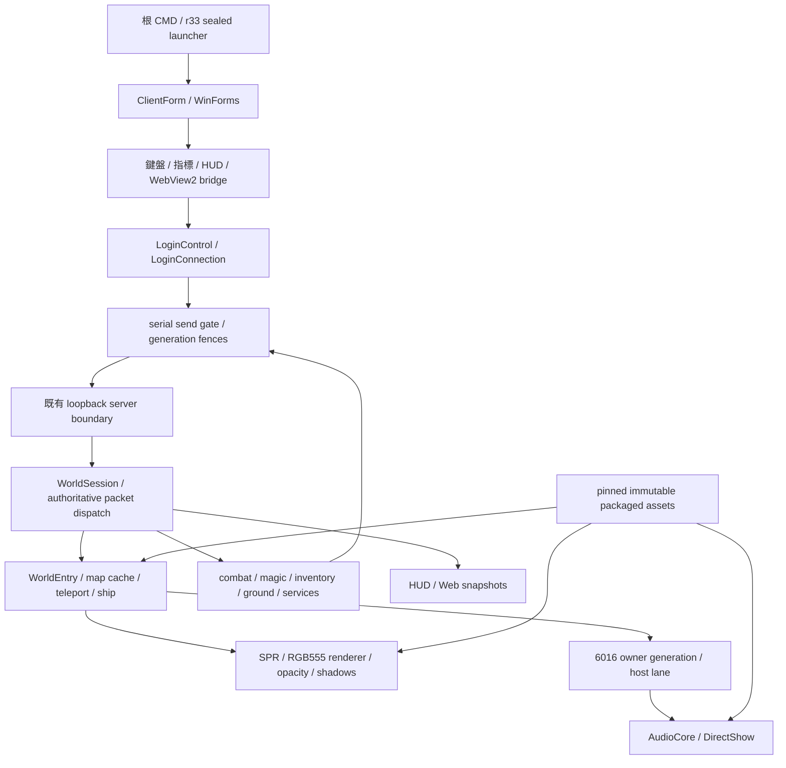

# P25 — r33 架構與可驗收責任基線

P25 是新的架構／責任盤點交付，不是 P24 改名或全案驗收。正式入口觀察為 r33；r29–r33 是既有離線接受紀錄，nativeLiveAccepted=false。r34 僅隔離 stage 已接受，canonical plan 封存，尚不能稱現行正式 r34。本文不執行產品 build、測試、socket、GUI、DB、服務或角色操作。

## 架構與資料所有權



`WorldSession` 持有封包衍生世界與服務狀態；`LoginConnection` 持有連線、傳送鎖與 session generation。局部 `World` 是動畫／呈現模型，不能把本地預測當逐步伺服器 ACK。`ClientForm` 由多個 partial 檔案組成，串接輸入、UI、世界同步與繪製；模組表表示責任界面，並非聲稱現有程式已分成互不耦合的套件。原始 P07 `HeadingConnection` 是另一條測試／展示路徑。

跨圖、換角、取消與非同步傳送用 world/session/actor/revision/lease 防止舊工作落入新世界。r33 的核心增量是 Ground/WorldEntry 傳送生命週期，並未加入 r34 拾取呈現。有限 A* 只處理已載入可通行範圍，最大距離64、步數128、展開8192；不宣稱原 BIN 尋路等價。支援速度仍限 Speed0/1/2、Brave0；技能 catalog 明確只接受1/3/4/8。

6016 的 map lifetime → controller → host lane → audio transport → command thread → DirectShow 與 GUI focus/音量門檻分開。3332/1340 是允許的音訊 ID。PlaySubmitted 僅是原生命令接受；歷史 standalone own-PID 訊號量測不等於正式世界聲音已驗。

WebView2 是本機子視窗，不是原 Awesomium ABI 重建。現行 origin/schema/command 檢查與 epoch/revision 有實際接線；P09 的僅三命令／1024字元敘述只屬歷史，r33 dispatcher 已擴為32768字元上限及各有限服務命令。native pixels/mouse/focus 的未驗須由 P27 準備及主管後續實測承接。

## 模組責任

完整 source paths、符號行、資料流、相依、既有驗證、unknown、下一步、完成標準及承接階段見 `module-map.json`。下表為工作分界：

| ID | 模組 | 覆核／承接 |
| --- | --- | --- |
| M01 | 入口、登入與通訊 | P11–P14 historical、P25 baseline、supervisor native acceptance |
| M02 | 世界、物件與跨圖生命週期 | P13/P15/P23/P24 historical、P25 baseline、P26 ground boundary |
| M03 | 移動、指標與鍵盤焦點 | P06/P14 historical、P27 review/candidate、supervisor native acceptance |
| M04 | 戰鬥、遠程、技能與獎勵 | P16/P19/P21/P22 historical、P25 baseline、future bounded content contract |
| M05 | 物品、裝備與基本補給 | P17/P20 historical、P25 baseline、supervisor bounded follow-up |
| M06 | 地面拾取與丟棄 | P18 historical、P26 review、original integrator canonical work |
| M07 | NPC、交易、倉庫、私商與場景服務 | P17–P24 historical、P25 baseline、supervisor native/resource coordination |
| M08 | 渲染、資源、外觀與遮擋 | P02–P06/P20/P23/P24 historical、P25 baseline、P26 pickup profiles |
| M09 | 6016 控制器與音訊 | P24 6016 lineage、P25 stale-state reconciliation、supervisor native audio |
| M10 | WebView2、HUD 與聊天介面 | P08/P09 historical、P27 input review、P25 architecture |
| M11 | 建置、啟動核驗與封存 | P09/P24 historical、P25 pins、P26 plan review、original integrator |

P25 產物 owner 是本對話；P26 負責拾取 canonical 計畫／門檻及擴展前提的獨立覆核；P27 負責 UI/input 的可重現缺陷查核與 native 準備。唯一共享產品整合 owner 仍為原整合者 `01a17a22-17e4-70c0-9792-166ddb86ea42`，須新主管 exact receipt。這份責任映射不新增寫入或原生操作授權。來源不明的後續實作階段保持 unassigned，不捏造 P28 等派工。

## 版本、證據與舊清單對帳

| 版本 | 接受範圍 | 層級 |
| --- | --- | --- |
| r29 | Speed2/Brave0 walking and object rendering only; slowed non-walk actions remain refused | 既有 offline receipt；本輪未重跑；native=false |
| r30 | Speed2/Brave0 existing supported attacks and skills1/3/4/8 with captured actor timing and lifecycle fences | 既有 offline receipt；本輪未重跑；native=false |
| r31 | Speed1/Brave0 existing supported attacks and skills1/3/4/8 with per-frame rounding, captured timing and deadline highwater | 既有 offline receipt；本輪未重跑；native=false |
| r32 | Speed2/Brave0 exact ordinary haste potion single use; known item speed qualification and admission/completion ownership protections | 既有 offline receipt；本輪未重跑；native=false |
| r33 | Existing normal pickup and shared manual drop sender lifecycle ownership; no new Slow opening or animation | 既有 offline receipt；本輪未重跑；native=false |

`completion-matrix.json` 保留舊矩陣32列（R01–R23、MAP-F1–F9）全文，每列另附來源錨點、owner、對帳分類及 backlog。另保留兩份舊文件各7個 remaining 與1個 direct fix，共16個補充 occurrence；重複 ID 不合併丟失來源。這些是完整對帳分母，不是完成率。

舊矩陣自身存在時間層混用：remaining/S2 和 directProductFixes 仍說6016待整合，但同檔 current6016/r28Current 已記錄 r28 正式整合。P25 以實際 r33 source 與較新接受證據標為舊待辦過時，留下正式世界 native 音訊及其他 token 缺口。舊 r19/r20/r21/r22/r27/r28 原生成功、失敗與部分驗收一律保留原版本。歷史 DB 內容僅引用既有報告，沒有新查詢或宣稱目前 DB 仍相同。

R15 舊鑰匙精確刪除時刻不可回補；R07/R10 原正向交易條件限制不是程式缺陷。R16/R20/R22 原生畫面／滑鼠缺證不是已重現 bug。MAP-F4 則是實際 local-effect group fade 缺口，但缺真實非零關聯與最終 renderer 契約，不能直接猜補丁。MAP-F5 只6016已接線，其他 event tokens 仍未完成；MAP-F6/F7 的舊排除數保持歷史，不冒充本輪重掃。

`historical-evidence-index.json` 逐筆保留引用原文、可解析路徑及 SHA256；只在列明的既有根解相對路徑，找不到的明列未解析，不假定檔案全球不存在。全文矩陣 pin 可核原始主張；解析到的文件 hash 不等於本輪重新驗證其 native 內容。

## r34 與後續有限工作

r34 stage seal 是 `9544f137a10914825b53080d4d390d17902cd40866467cebbf69578290240018`；canonical plan SHA 是 `d25c306fae5abee9209e46c557453f7b6a0a96645e5c052fbda70555f11f15ff`。stage nativeNeutral/nativeFIFO/nativeVariant/nativeRuntimeTiming/slowQualified/sameBinVersion 全為 false。計畫44 operations、138 copy mappings、10 helpers 與預期 assertions 不算 P25 或 canonical 執行成功。raw-log adapter 修正的計畫說明及主管更換 gate 由 P26 exact review 接手，P25 不替其下結論。

其餘41 profiles 只是封存規劃／覆核準備；42組來源足夠支持有限自有政策不等於 native eligible。新資源12組288幀、2,473,547 bytes 是計畫量，payload 未產出；312 pickup pose shadow keys 缺口保留。需 final r34 base、明確契約與獨立覆核後才能實作。P25 盤點不等待此依賴。

`finite-backlog.json` 的12個有限項分開 integration/review、source-blocked implementation、native acceptance、external conditions、historical limit。已接線功能不再重派整類實作；尚缺源的功能不冒充已完成；沒有原生結果就不勾通過。

## Pins、重跑與限制

`source-binding.json` 比對 r33 accepted source manifest 的每筆 engine 及 sealed release 來源。`source-pins.json` 記錄本輪所有來源 SHA256。launcher 只比對 runtime/web 的完整 hash 與 assets inventory presence/size，素材本文由產品載入時核 hash；P25 不重新逐像素或全資產本文審查，不把 launcher check-only 當 native。

```powershell
python -B -X utf8 "D:\lineage開發\TW1608262200研究\work\P25-architecture-baseline-r1\verify_baseline.py"
```

重建文件（只寫本 P25 root）命令見 `commands.json`。核驗器只驗 JSON 對帳、引用、來源 SHA、模組必備欄位與封存產物，不執行產品測試。若共享來源已改版，核驗應報 drift，保留本基線並由主管要求新版盤點，不能自動把 r34 改標 r33。
